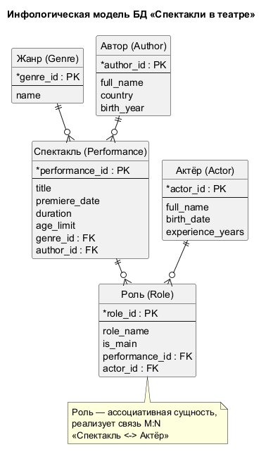
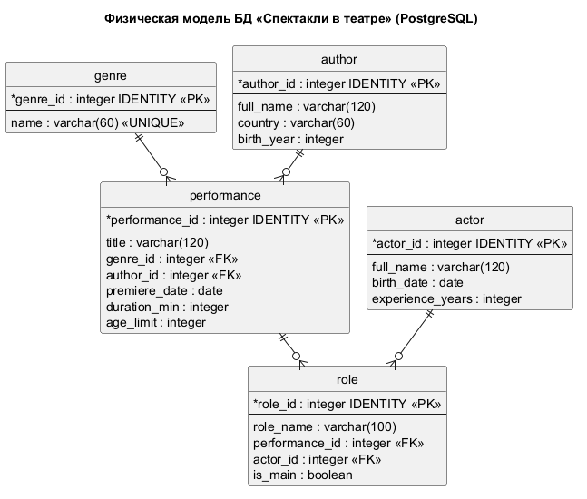

# Модели БД «Спектакли в театре»

Инфологическая и физическая модели базы данных театральных спектаклей
(5 таблиц, по 10 записей — реализация в `theater.sql`, СУБД PostgreSQL).

**Инструмент:** [DBML / dbdiagram.io](https://dbdiagram.io) — для текстовых моделей,
[PlantUML](https://plantuml.com) — для рендеринга диаграмм в изображения.

## Файлы

| Файл | Что это |
|---|---|
| `theater.sql` | SQL-скрипт: схема + данные (PostgreSQL) |
| `model_conceptual.dbml` | инфологическая модель (DBML) |
| `model_physical.dbml` | физическая модель (DBML) |
| `model_conceptual.puml` | исходник инфологической диаграммы (PlantUML) |
| `model_physical.puml` | исходник физической диаграммы (PlantUML) |
| `model_conceptual.png` | **изображение №1** — инфологическая модель |
| `model_physical.png` | **изображение №2** — физическая модель |

---

## 1. Инфологическая (концептуальная) модель

Описывает предметную область на логическом уровне: сущности, их атрибуты и связи
(без привязки к СУБД и типам данных).



### Сущности

| Сущность | Атрибуты |
|---|---|
| **Жанр** | `genre_id (PK)`, `name` |
| **Автор** | `author_id (PK)`, `full_name`, `country`, `birth_year` |
| **Спектакль** | `performance_id (PK)`, `title`, `premiere_date`, `duration`, `age_limit`, `genre_id (FK)`, `author_id (FK)` |
| **Актёр** | `actor_id (PK)`, `full_name`, `birth_date`, `experience_years` |
| **Роль** | `role_id (PK)`, `role_name`, `is_main`, `performance_id (FK)`, `actor_id (FK)` |

### Связи и кардинальности

| Связь | Кардинальность | Смысл |
|---|---|---|
| Жанр — Спектакль | `1 : ∞` | один жанр у многих спектаклей |
| Автор — Спектакль | `1 : ∞` | один автор у многих спектаклей |
| Спектакль — Роль | `1 : ∞` | у спектакля много ролей |
| Актёр — Роль | `1 : ∞` | актёр может играть много ролей |

Сущность **Роль** — ассоциативная: она разворачивает связь **M : N**
«Спектакль ↔ Актёр» (один актёр играет много ролей в разных спектаклях,
в одном спектакле много актёров).

---

## 2. Физическая (даталогическая) модель

Конкретная реализация под PostgreSQL: реальные типы, ключи, ограничения, индексы.
Соответствует `theater.sql` и живой БД `theater`.



### Таблицы и типы

| Таблица | Поля (тип) | Ограничения |
|---|---|---|
| `genre` | `genre_id integer`, `name varchar(60)` | PK, IDENTITY; `name UNIQUE`, `NOT NULL` |
| `author` | `author_id integer`, `full_name varchar(120)`, `country varchar(60)`, `birth_year integer` | PK, IDENTITY; `full_name NOT NULL`; `CHECK (birth_year BETWEEN 1000 AND 2100)` |
| `performance` | `performance_id integer`, `title varchar(120)`, `genre_id integer`, `author_id integer`, `premiere_date date`, `duration_min integer`, `age_limit integer` | PK, IDENTITY; FK → `genre`, FK → `author`; `CHECK (duration_min BETWEEN 30 AND 400)`; `CHECK (age_limit IN (0,6,12,16,18))` |
| `actor` | `actor_id integer`, `full_name varchar(120)`, `birth_date date`, `experience_years integer` | PK, IDENTITY; `CHECK (experience_years BETWEEN 0 AND 90)` |
| `role` | `role_id integer`, `role_name varchar(100)`, `performance_id integer`, `actor_id integer`, `is_main boolean` | PK, IDENTITY; FK → `performance`, FK → `actor` (`ON DELETE CASCADE`); `is_main DEFAULT false` |

### Внешние ключи

```
performance.genre_id  → genre.genre_id
performance.author_id → author.author_id
role.performance_id   → performance.performance_id   (ON DELETE CASCADE)
role.actor_id         → actor.actor_id               (ON DELETE CASCADE)
```

### Индексы

PostgreSQL **не создаёт индексы по внешним ключам автоматически**.
В физической модели добавлены индексы по всем FK-полям:

```sql
CREATE INDEX idx_performance_genre  ON performance(genre_id);
CREATE INDEX idx_performance_author ON performance(author_id);
CREATE INDEX idx_role_performance   ON role(performance_id);
CREATE INDEX idx_role_actor         ON role(actor_id);
```

---

## Как отрендерить / отредактировать

### DBML (dbdiagram.io)
1. Открой [dbdiagram.io/d](https://dbdiagram.io/d).
2. Вставь содержимое `model_conceptual.dbml` или `model_physical.dbml`.
3. Экспорт: **Export → PNG / PDF / PostgreSQL SQL**.

### PlantUML (локально, нужна Java)
```powershell
# скачать jar: https://github.com/plantuml/plantuml/releases
java -jar plantuml.jar -charset UTF-8 -tpng model_conceptual.puml model_physical.puml
```
Диаграммы используют встроенный движок компоновки `smetana`
(`!pragma layout smetana`), поэтому **Graphviz не требуется**.
